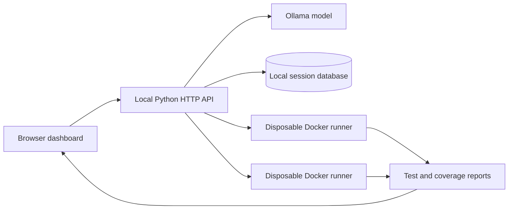

# FixLab

**Find the bug. Review the patch. Prove it with regression tests.**

[](https://github.com/uniyal802/fixlab/actions/workflows/ci.yml) [](https://uniyal802.github.io/fixlab/)

FixLab is an AI-assisted Python debugging workbench. It analyzes a Python module and an error description, proposes a corrected version with tests, shows the patch for review, and runs the same tests against the original and updated code.

| Project link | Status |
| --- | --- |
| Live browser edition | [Open FixLab on GitHub Pages](https://uniyal802.github.io/fixlab/) |
| Source | [github.com/uniyal802/fixlab](https://github.com/uniyal802/fixlab) |
| Project board | [FixLab Product Roadmap](https://github.com/users/uniyal802/projects/8) |
| Continuous integration | [GitHub Actions](https://github.com/uniyal802/fixlab/actions/workflows/ci.yml) |
| GitHub deployment history | [Deployments](https://github.com/uniyal802/fixlab/deployments) |
| GitHub workflow guide | [Issues, pull requests, agents, projects, and deployment](docs/GITHUB_WORKFLOW.md) |
| Product roadmap | [SCALE_ROADMAP.md](SCALE_ROADMAP.md) |

## Product workflow

1. Provide a Python module and the error or unexpected behavior.
2. Generate an explanation, a complete proposed module, regression tests, and a unified diff.
3. Review or edit the generated code and tests.
4. Run the same test suite against the original and proposed code in isolated environments.
5. Inspect the test output and statement-line coverage, then record a review decision or export the session.

## Current capabilities

- Real local model inference with Ollama in the local edition, and WebGPU inference in the browser edition.
- Python syntax validation and normalization of generated tests that omit imports.
- Reviewable diffs, editable revisions, session history, review decisions, and JSON/Python exports.
- Original-versus-fixed execution with test counts, failures, errors, skips, duration, and statement-line coverage.
- A 21-case labeled evaluation harness with independent reference tests, Wilson confidence intervals, and mutation checks; run it before quoting any model-quality figures.
- Docker execution limits for the local development runner; a browser Worker/iframe sandbox for the Pages edition.
- GitHub Actions CI on pushes and pull requests.

## Run locally

Requirements: Python 3.9 or newer. The local HTTP server and application code use the Python standard library.

```bash
git clone https://github.com/uniyal802/fixlab.git
cd fixlab
./start.sh
```

Open [http://127.0.0.1:8000](http://127.0.0.1:8000), load the example, and follow the readiness instructions in the dashboard.

### Enable AI analysis

Install [Ollama](https://ollama.com), start it, and download the default model:

```bash
ollama pull qwen2.5-coder:7b
```

The default Ollama endpoint is `http://127.0.0.1:11434`. Configure `OLLAMA_URL` or `OLLAMA_MODEL` in the server environment to use another endpoint or model. Model memory and response time depend on the selected model and hardware.

### Enable isolated test execution

Install and start Docker, then build the runner image from the repository root:

```bash
docker build -f Dockerfile.runner -t fixlab-runner:local .
```

The local runner starts a fresh container for each original/fixed execution. It uses no network, a read-only root and submission mount, an unprivileged user, dropped capabilities, CPU/memory/process limits, and a 20-second deadline. It does not fall back to executing submitted code in the API process. Displayed output is capped at 32 KB.

These settings are useful for local development, but Docker alone is not a hardened multi-tenant execution service. Do not expose the local backend publicly.

## Browser edition

The static edition is served from [`docs/`](docs/). It runs Qwen2.5-Coder-1.5B inference with WebLLM/WebGPU and executes Python tests with Pyodide in a Worker hosted in an opaque-origin iframe. The model downloads on first use; a supported browser and GPU are required. Sessions remain in that browser's local storage, with a 30-session cap. No FixLab AI server is used for this edition.

Deployment is provided by GitHub Pages: [uniyal802.github.io/fixlab](https://uniyal802.github.io/fixlab/). If the link is unavailable, check the repository's **Settings → Pages** configuration.

## Architecture



The local edition uses a vanilla JavaScript frontend, a standard-library Python HTTP server, SQLite, Ollama, and Docker. The browser edition is a separate static application with client-side model inference and execution. See [the architecture notes](docs/ARCHITECTURE.md) for execution boundaries and data handling.

## API overview

The local edition exposes a same-origin JSON API:

| Endpoint | Purpose |
| --- | --- |
| `GET /api/health` | Check configured model and Docker runner readiness. |
| `POST /api/analyze` | Queue analysis and return a durable `job_id` (`202 Accepted`). |
| `GET /api/jobs/<id>` | Read job state and, when complete, its result or bounded error. |
| `POST /api/jobs/<id>/cancel` | Cancel a queued or running local job. |
| `GET /api/sessions` | List recent local sessions. |
| `GET /api/sessions/<id>` | Retrieve one local session. |
| `POST /api/edit` | Save a revised proposed module and tests. |
| `POST /api/run` | Queue isolated original/proposed test runs and return a `job_id`. |
| `POST /api/review` | Record an accepted or rejected review decision. |
| `POST /api/delete` | Delete a local session. |

Session data is stored locally in plaintext. Accepting a patch records a review decision; it does not change a Git repository.

The API submits slow work to a SQLite-backed local queue. Run the project with `./start.sh` to start both the HTTP API and its separate worker. Jobs survive API restarts; a restarted worker requeues interrupted jobs once, and each job has a hard deadline. Worker concurrency is configurable with `FIXLAB_WORKERS` (1–4, default 1). The default per-owner limits are 20 active jobs, 100 KB per request, and 100 MB of stored session/job data; hosted deployments can override these defaults per token. Test output is capped at 32 KB per container, and job errors are capped at 2,000 characters. The local default remains single-user and loopback-only.

The API supports an opt-in owner-scoped bearer-token mode and configurable retention. See [Identity, quotas, and data retention](docs/IDENTITY_AND_DATA.md) for setup, database migration, and the limits of this API-only identity adapter. This does not add a sign-up flow or make the project ready for public code execution.

## Verification

Run the unit and API suite from the repository root:

```bash
python3 -m unittest discover -s tests -v
```

The CI workflow also builds the Docker runner and checks the JavaScript syntax. Docker integration tests run when Docker is available. See [verification notes](docs/VERIFICATION.md) for coverage and known limitations.

## GitHub workflow and planned integrations

This repository has a GitHub Project board, issue forms, coding-agent instructions, PR templates, and CI for pushes and pull requests. The FixLab application itself does not yet integrate with GitHub Issues or Projects, run coding agents, import repositories, or open pull requests; those are planned product capabilities in the [scaling roadmap](SCALE_ROADMAP.md). Until repository authorization and a safe patch workflow are implemented, apply exported patches manually and review all generated code.

## Portfolio and resume

Suggested resume bullet, after personally reproducing the listed flow:

> Built FixLab, an AI-assisted Python debugging workbench that generates reviewable patches and regression tests, compares original and proposed code in isolated runners, and reports test and statement-line coverage using Ollama, SQLite, and Docker.

Keep claims about model quality, performance, usage, coverage, and production readiness tied to results you have measured. [Portfolio demo steps](docs/DEMO.md) describe a concise walkthrough.

## Project documentation

- [Architecture and engineering decisions](docs/ARCHITECTURE.md)
- [Demo and resume notes](docs/DEMO.md)
- [Verification record](docs/VERIFICATION.md)
- [Product workflow](docs/WORKFLOW.md)
- [Evaluation harness](docs/EVALUATION.md)
- [GitHub workflow and project setup](docs/GITHUB_WORKFLOW.md)
- [Identity, quotas, and data retention](docs/IDENTITY_AND_DATA.md)
- [Coding-agent guide](AGENTS.md)
- [Scaling roadmap](SCALE_ROADMAP.md)

## Safety and limitations

- AI-generated code and tests may be incorrect. A passing test suite is evidence, not a correctness proof.
- Statement-line coverage is not branch coverage.
- The default local backend uses one local owner, binds to loopback, and stores sessions locally in plaintext. Hosted-mode bearer credentials must be configured and protected by the operator; the repository does not provide an identity provider or sign-up flow.
- Docker is a development isolation boundary, not a hardened public multi-tenant service. A production service requires stronger execution isolation, authentication, quotas, bounded storage, and deployment-specific security review.
- Do not submit secrets or sensitive source code to a model or environment unless you have reviewed its data handling.
