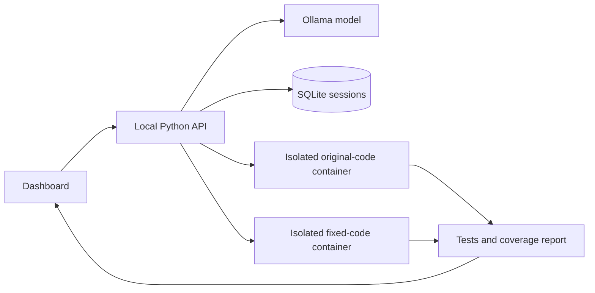

# Architecture and engineering decisions

FixLab is a local Python debugging workbench. The browser calls a same-origin HTTP API. Ollama proposes a complete corrected module and unittest suite. The backend parses Python syntax, repairs missing imports of module functions/classes, computes a unified diff, and saves a session in SQLite. The user can revise and review the suggestion.

## Execution contract

The exact same test module runs against original and fixed code. Each execution gets a new container and read-only submission folder. Python code never executes in the API process. Docker must already contain the locally built runner image; execution never pulls an image. Docker setup errors are distinct from test failures.

The container emits a structured `FIXLAB_REPORT` containing test counts, failures, errors, skips, covered and missing statement lines, and statement-line coverage percentage. This coverage metric counts AST statement start lines; it is not branch or expression coverage. Suites with no tests or only skipped tests fail. An original failure followed by fixed success is evidence for the generated tests, not a correctness guarantee. Generated code can fabricate output; this is an untrusted development tool, not a proof system.

Edits, reviews, deletes, and execution are serialized to prevent stale runs from overwriting newer revisions. Editing clears test evidence and resets review status. SQLite stores sessions, explanations, source and test output as local plaintext.

## Scope

Python standard-library modules only. Local, single-user workbench. Vanilla JavaScript frontend, Python standard-library HTTP backend, SQLite, Ollama, Docker. No React/FastAPI/PostgreSQL dependencies in version 1. No GitHub account integration, cloud deployment, public execution, or authentication is claimed.

## Future extensions

Background execution jobs, multi-file projects, PostgreSQL migration, repository pull requests, and stronger isolated workers can be added after the local workflow is verified. CI executes real Docker integration tests on GitHub-hosted Linux runners; local tests skip these when Docker is absent.

## Free browser edition

GitHub Pages serves static assets from docs/. WebLLM 0.2.86 performs real Qwen2.5-Coder-1.5B inference using WebGPU. Pyodide 0.28.3 runs the Python test suite in a Worker within a sandboxed opaque-origin iframe. A CSP limits runner script/network loading to the pinned Pyodide CDN path; the runner cannot access the application's DOM or browser storage. Each execution gets a fresh frame/Worker and a 60-second deadline. Generated code remains untrusted and can influence its own results. Browser sessions use localStorage with a 30-session cap; this differs from SQLite storage in the local edition. Inference is on the user's GPU, not a cloud server.
