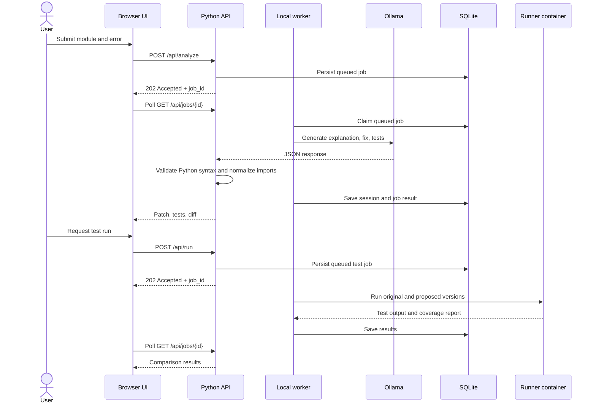

# Architecture and engineering decisions

FixLab has two editions with different execution and persistence models:

| Edition | Interface and API | Model inference | Test execution | Session storage |
| --- | --- | --- | --- | --- |
| Local | Vanilla JavaScript served by the Python standard-library HTTP server | Ollama on the user's machine | Docker runner container | SQLite on the user's machine |
| Browser | Static app in `docs/`, served by GitHub Pages | WebLLM with WebGPU on the user's device | Pyodide in a Worker hosted in an opaque-origin iframe | Browser `localStorage` (30 sessions maximum) |

The editions offer a similar product workflow, but use separate UI assets and different runtime paths. The local API does not currently connect to GitHub or create pull requests.

## Local request flow

The local HTTP server binds to `127.0.0.1:8000`. `start.sh` starts a separate SQLite-backed worker alongside it. Analysis and test requests return a job ID promptly; clients poll job state and can request cancellation. Jobs and results survive API restarts. The worker recovers interrupted jobs once, limits concurrency to 1–4, enforces 190-second analysis and 55-second test-job deadlines, and allows one retry. A queue cap of 200 active jobs prevents unbounded admission. This remains a single-user local workflow, not a public service or multi-host queue.

## Test execution contract

The same generated test module is used for original and proposed code. Each version runs in a new container with a read-only submission mount, no network, an unprivileged user, dropped capabilities, resource limits, and a 20-second timeout. The runner image must already exist locally; the backend does not pull images. Python source is not executed in the API process.

The runner emits a structured report containing test counts, failures, errors, skips, covered and missing statement lines, and statement-line coverage. It counts AST statement start lines; it does not measure branches or expressions. Empty and all-skipped suites fail. An original failure followed by a proposed pass shows that the generated suite distinguishes those runs; it does not prove the fix is correct. Submitted and generated code is untrusted.

These Docker settings are a local development boundary. A hosted service needs a separately reviewed isolation design, per-job limits, bounded storage, quotas, and operational cleanup.

## Persistence and concurrency

The local edition stores source code, explanations, test output, job inputs/results, and review decisions in plaintext in `data/sessions.db`. There are no accounts, tenant ownership checks, retention policy, or cloud backups. Editing a session increments its revision, clears prior test results, and resets the review decision. The worker and API share the local SQLite database; do not expose this service to untrusted network clients.

The browser edition stores at most 30 sessions in local storage. Data remains in that browser profile and is not synchronized with the local edition.

## Browser execution boundary

The Pages edition uses pinned WebLLM and Pyodide versions. Python execution runs in a Worker inside an opaque-origin iframe, with a content security policy restricting runner asset and network loading to the pinned Pyodide CDN path. Each execution uses a fresh frame and Worker with a 60-second deadline. This separation reduces access to the application DOM and browser storage, but generated code may still affect its own test results; it is not a proof system.

## CI

GitHub Actions runs on pushes and pull requests. The workflow builds the Docker runner image, runs the Python unit/API and integration suite, and checks JavaScript syntax for the local and browser editions.

## Planned evolution

The [scaling roadmap](../SCALE_ROADMAP.md) sequences the hosted service boundary, durable background jobs, accounts and tenant-safe storage, isolated workers, and operational metrics. Repository import, GitHub Issues/Projects, coding-agent workflows, and pull request creation are product ideas; they are not implemented in the current application.
