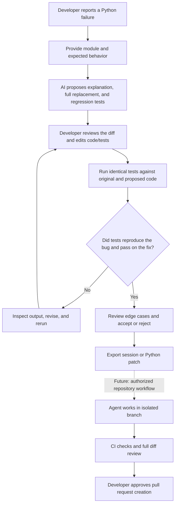

# FixLab product workflow

FixLab is designed around a human-reviewed debugging loop. The current browser edition supports the investigation, patch review, and test comparison steps. GitHub repository access, coding-agent execution, and pull-request creation are future product milestones, not current app features.

## Current behavior

1. **Describe:** paste or import a Python module and explain the error or expected behavior.
2. **Analyze:** the browser edition requests a proposed explanation, replacement module, and `unittest` cases from a WebGPU model running on the user's device.
3. **Review:** inspect the generated diff, edit the code or tests, and save a revision. Saving resets previous test results and review state.
4. **Verify:** run the exact same test module against original and proposed code in separate browser sandboxes. Inspect pass/fail output and statement-line coverage.
5. **Decide:** accept or reject the proposal, then export the JSON session or Python module. Acceptance records a local review decision; it does not modify a Git repository.

## Trust boundaries

- The browser model and Python runtime execute on the visitor's device; model weights are downloaded on first use.
- Browser sessions stay in that browser's local storage. The static Pages app does not persist them to a FixLab server.
- AI output is untrusted. A passing generated suite demonstrates only that those tests pass; it does not prove correctness.
- GitHub repository access, issue/project synchronization, coding agents, and automatic PR creation are not implemented in the app today.
- A future agent flow must use an authorized source revision, disposable isolated worker, constrained permissions, auditable logs, CI, and explicit user approval before opening a PR.

See [Architecture](ARCHITECTURE.md), [GitHub workflow](GITHUB_WORKFLOW.md), and [Scaling roadmap](../SCALE_ROADMAP.md) for implementation status and planned boundaries.
